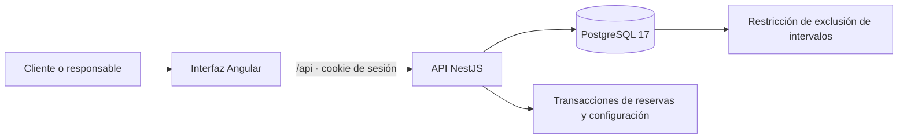
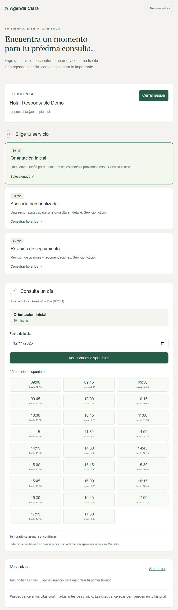
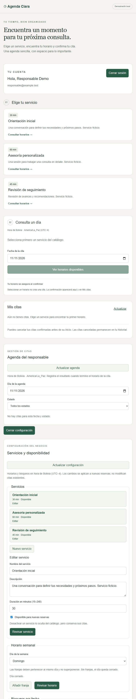

# Agenda Clara

**Reservas de servicios y citas · Angular + NestJS + PostgreSQL**

Aplicación full stack para un negocio de servicios con una sola agenda. Permite consultar disponibilidad, reservar sin superponer citas y gestionar horarios desde un panel de responsable.

Proyecto 02 del portafolio de **Richard Grichukin Mendez**. Versión funcional local con **57 pruebas aprobadas**. Publicación autorizada; primera ejecución de GitHub Actions pendiente de verificación.

## Qué demuestra

- Reglas de negocio verificadas en el servidor, no solo en la interfaz.
- PostgreSQL como garantía contra reservas simultáneas incompatibles.
- Permisos por rol y acceso del cliente únicamente a sus propias citas.
- Coordinación entre reservas y cambios de disponibilidad dentro de transacciones.
- Pruebas de integración con PostgreSQL real y pruebas de interfaz Angular.

## Funciones

| Cliente | Responsable |
| --- | --- |
| Consultar servicios y horarios | Consultar agenda por fecha y estado |
| Crear cuenta e iniciar/cerrar sesión | Registrar atención o inasistencia después del fin de la cita |
| Confirmar una reserva y consultar Mis citas | Crear, editar y desactivar servicios |
| Cancelar citas propias antes del inicio | Configurar franjas semanales y bloqueos por fecha |

Los intervalos son semiabiertos: una cita puede comenzar cuando termina otra. Una reserva conserva nombre del servicio e intervalo originales aunque el catálogo cambie. Los cambios de horario y bloqueos que contradigan citas confirmadas se rechazan. Zona del negocio: **America/La_Paz (UTC−4)**.

## Arquitectura



Una aplicación, una API y una base independiente. Sin microservicios ni servicios cloud innecesarios para este alcance. [Decisiones y contratos HTTP](docs/architecture.md).

## Ejecutar localmente

Requisitos: Node.js **22.23.1**, npm y Docker Desktop con motor Linux. No requiere Angular CLI ni Nest CLI globales.

1. Copia `.env.example` a `.env` y define una contraseña local para `DB_PASSWORD`.
2. Desde la raíz del proyecto:

   ```powershell
   docker compose up -d --wait
   npm.cmd --prefix backend ci
   npm.cmd --prefix frontend ci
   .\scripts\start-api.ps1
   ```

3. En otra terminal:

   ```powershell
   cd frontend
   npm.cmd start
   ```

4. Abre http://127.0.0.1:4201 y crea una cuenta con datos ficticios. No hay contraseñas ni usuarios privilegiados predeterminados. La preparación de un responsable se describe en la [guía de ejecución](docs/runbook.md).

Puertos locales: interfaz **4201**, API **3001**, PostgreSQL **5434**. El volumen conserva los datos. Para detener PostgreSQL usa `docker compose stop`; no elimines el volumen si quieres conservar las citas.

## Pruebas y automatización

| Área | Pruebas aprobadas | Casos destacados |
| --- | ---: | --- |
| Servidor | 30 | permisos, sesiones, fechas, cancelaciones, estados y concurrencia real |
| Interfaz | 27 | formularios, confirmación, conflictos y respuestas obsoletas |
| Total | **57** | compilaciones de servidor e interfaz aprobadas |

Desde backend, con PostgreSQL iniciado y `DB_PASSWORD` en el entorno: `npm test`. Las pruebas usan esquemas temporales aislados. Desde frontend: `npm test -- --watch=false` y `npm run build`.

[GitHub Actions preparado](.github/workflows/ci.yml) para pruebas, migraciones y compilación; **todavía no ejecutado en GitHub**. No realiza despliegues. [Detalle del flujo](docs/ci.md) y [registro de validación](docs/validation.md).

## Evidencias

Capturas reales de la aplicación local, con cuenta y servicios ficticios. No representan una cita confirmada ni un despliegue público.

<details>
<summary>Catálogo y disponibilidad</summary>



</details>

<details>
<summary>Configuración del responsable</summary>



</details>

[Procedimiento y límites de las evidencias](evidence/README.md).

## Seguridad y alcance

Sesiones de 12 horas en cookie HttpOnly/SameSite; contraseñas con scrypt; consultas parametrizadas; validación de entradas; protección de escrituras y controles por propietario/rol. La demostración escucha únicamente en 127.0.0.1. [Controles y límites](docs/security.md).

Sin pagos, correos automáticos, recuperación de contraseña, sucursales, varios profesionales ni calendarios externos. No está presentado como un servicio de producción. [Alcance completo](docs/scope-proposal.md).

## Autor y licencia

[Richard Grichukin Mendez](https://github.com/richardgrim) · [Portafolio](https://github.com/richardgrim/portfolio)

Código disponible bajo [licencia MIT](LICENSE). [Plan de publicación](docs/publication-plan.md).
